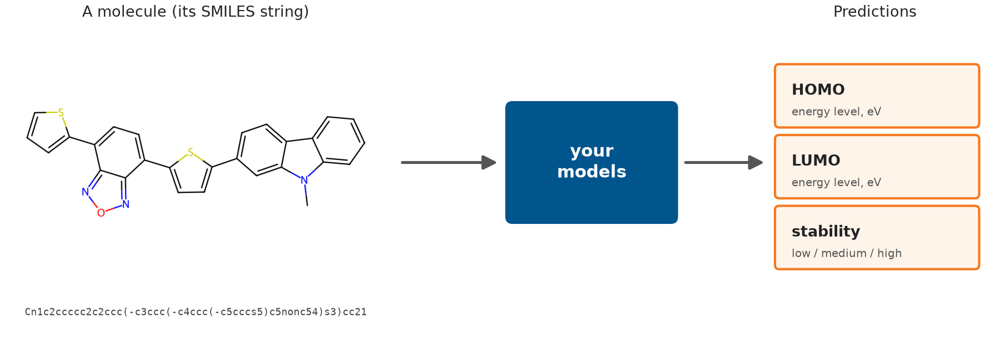

# DataLab Project {.unnumbered}

The DataLab Project is the applied component of the course. You will use the concepts introduced in the self-study material to solve a real machine-learning problem.

## The project

Your client, the OMEGA Lab, develops organic solar cells. To find out whether a new molecule is a good material for a solar cell, the lab has to make it and measure it, which takes weeks. The lab would like to know which molecules are worth that effort before anyone makes them.

{fig-alt="Diagram: a drawing of an organic molecule with its SMILES string, an arrow to a box labeled your models, and an arrow to three predictions: HOMO (energy level in eV), LUMO (energy level in eV) and stability (low, medium or high)."}

Your task is to build models that take a molecule and predict three of its properties: the HOMO and LUMO energy levels (a regression problem) and its stability (a classification problem with the classes `low`, `medium` and `high`). Each molecule is given as a SMILES string, a line of text that describes its structure.

[Iteration 1](iteration-1/index.qmd) starts with a deeper understanding of the problem.

## How the project works

The project follows an **iterative CRISP-DM workflow**. Rather than completing each part of the machine-learning process only once, you will revisit data understanding, data preparation, modeling, and evaluation as your understanding of the problem develops.

As you progress through the project, the level of guidance gradually decreases.

## At a glance

| | Data | Guidance | You end with |
|---|---|---|---|
| **Iteration 1** | `starter_dataset.xlsx`: 80 molecules, ready for modelling | Step by step | Your first classification, regression and clustering models |
| **Iteration 2** | The raw HOPV files: 350 molecules | Structured notebooks; more decisions are yours | Your own dataset and a baseline on it |
| **Iteration 3** | Your HOPV dataset | Structured notebooks | Cross-validated, tuned models and your first Kaggle submission |
| **Iteration 4** | HOPV + a lab database + the Kaggle molecules | Pointers only | Your models as pipelines, trained on more data, and an explanation of your Kaggle score |
| **Iteration 5** | All sources | Pointers only | Better models, and a validation you can trust |
| **Iteration 6** | All sources | Pointers only | Your final Kaggle submissions and a write-up of your solution as a portfolio project |

There are no deadlines and no grades: work at your own pace. The Kaggle leaderboard tells you how well your solution works on molecules it has never seen. When a notebook mentions what the client expects, such as a target score or a justification of your choices, treat it as advice rather than a requirement.

Self-study and DataLab take turns: each [Self-study theme](../self-study/index.qmd) is followed by the DataLab iteration with the same number, so Theme 1 comes before Iteration 1, Theme 2 before Iteration 2, and so on up to Theme 6 and Iteration 6. Together they form the six steps of the [course route](../start-here.qmd#the-course-route).

## Iterations

### [Iteration 1 — First ML Cycle](iteration-1/index.qmd)

Go through the complete machine-learning workflow for the first time and build your first classification, regression, and clustering models.

This iteration is highly guided. The goal is to experience the complete workflow quickly and establish your first working models rather than optimize performance.

### [Iteration 2 — Your Own Dataset](iteration-2/index.qmd)

Develop a stronger understanding of the problem and the data, turn the raw HOPV files into your own dataset, and train your Iteration 1 models on it as a baseline.

This iteration is still structured, but you will begin making more decisions yourself and applying concepts introduced in the self-study material.

### [Iteration 3 — Better Evaluation, First Submission](iteration-3/index.qmd)

Improve the baseline one step at a time with cross-validation and hyperparameter tuning, measure the quality of your clusters, and submit to the Kaggle competitions for the first time.

### [Iteration 4 — Streamlined Code, New Data](iteration-4/index.qmd)

From this point onward, the project becomes open-ended. Rebuild your models as pipelines so that each experiment is quick to run, add the lab database and the Kaggle molecules to your data, and find out why your Kaggle score differs from your cross-validation score.

### [Iteration 5 — Better Models](iteration-5/index.qmd)

Try tree-based models and boosting, build a validation strategy that resembles the Kaggle molecules, cluster all molecules, and analyze your errors.

### [Iteration 6 — Final Solution](iteration-6/index.qmd)

Read research on the problem and apply its ideas, keep improving, make your final Kaggle submissions, and write up your solution as a portfolio project.

There is no fixed sequence in Iterations 4 to 6. You may revisit any part of the machine-learning workflow, including data understanding, data preparation, feature engineering, validation, model selection, and hyperparameter tuning, and continue iterating based on evidence until you are satisfied with your solution.
