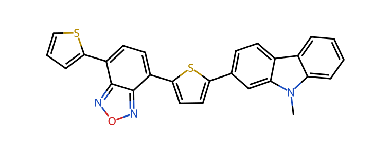

Every molecule in this project is given as a **SMILES** string (Simplified Molecular Input Line Entry System). In Iteration 1 you used these strings without reading them. In this iteration you work with the raw data, so it helps to know what a SMILES string says about a molecule, and what it does not say. You don't need to write SMILES strings yourself, and you don't need a chemistry background for this page.

::: {.column-margin}
**SMILES**: a way to write the structure of a molecule as a single line of text: its atoms, the bonds between them, and its rings.
:::

{.mol-row fig-alt="An organic molecule from the starter dataset: a chain of connected rings, with sulfur, nitrogen and oxygen atoms."}

```
Cn1c2ccccc2c2ccc(-c3ccc(-c4ccc(-c5cccs5)c5nonc54)s3)cc21
```

## Atoms

Each atom is written as its element symbol: `C` for carbon, `N` for nitrogen, `O` for oxygen, `S` for sulfur. Atoms written next to each other are bonded. So `CCO` is a carbon bonded to a carbon, bonded to an oxygen: ethanol.

Hydrogen atoms are usually left out. Every atom gets as many hydrogens as it needs to have its normal number of bonds. Carbon normally has four bonds, so the first `C` in `CCO` has three hydrogens. The drawings follow the same habit: a corner or end of a line without a letter is a carbon, and its hydrogens are not drawn.

::: {.mol-row layout-ncol="2"}
{fig-alt="Ethanol drawn as a zigzag line ending in OH."}

{fig-alt="Ethanol with all six hydrogen atoms drawn."}
:::

Some atoms need square brackets: elements outside the common set B, C, N, O, P, S, F, Cl, Br and I, such as silicon (`[Si]`), and atoms with a charge or an explicit hydrogen, such as `[O-]` or `[nH]`. You will see `[Si]` in some of the project molecules.

## Bonds

A single bond needs no symbol. A double bond is written as `=` and a triple bond as `#`.

::: {.mol-row layout-ncol="3"}
{fig-alt="Ethanol: single bonds only."}

{fig-alt="Acetaldehyde, with the carbon-oxygen double bond highlighted."}

{fig-alt="Acetonitrile, with the carbon-nitrogen triple bond highlighted."}
:::

## Branches

A SMILES string is read from left to right, like a path through the molecule. When the path splits, the side branch goes in parentheses, and the path continues after the closing parenthesis. In `CC(O)CC`, the `O` hangs off the second carbon, and the chain continues with two more carbons. Branches can contain bonds and further branches: in `CC(=O)O`, the branch is a double-bonded oxygen.

::: {.mol-row layout-ncol="2"}
{fig-alt="2-Butanol, with the OH group of the branch highlighted."}

{fig-alt="Acetic acid, with the double-bonded oxygen of the branch highlighted."}
:::

## Rings

A line of text cannot close a loop, so rings are written as a chain plus a label. A digit after an atom opens a ring, and the same digit later closes it: the two atoms with that digit are bonded. `C1CCCCC1` is a chain of six carbons in which the first and the last are bonded, a ring of six.

When a molecule has several rings, each ring gets its own digit while it is open. A digit can be used again after its ring is closed, so the digits count open rings, not all rings. In the long project molecule above, the digits go up to 5, but the molecule has more than five rings.

::: {.mol-row layout-ncol="2"}
{fig-alt="Cyclohexane, with the bond between the first and the last carbon highlighted."}

{fig-alt="Naphthalene, two fused rings, with the two ring-closure bonds highlighted."}
:::

## Aromatic rings

Lowercase letters mark atoms in an aromatic ring: a flat ring in which the electrons are shared over the whole ring, as in benzene. Benzene can be written as `c1ccccc1` or, with alternating single and double bonds, as `C1=CC=CC=C1`. Both strings describe the same molecule.

Aromatic rings are everywhere in this project. Organic solar-cell molecules are often long chains of rings like the ones below, for example rings with a sulfur atom (`s`).

::: {.mol-row layout-ncol="3"}
{fig-alt="Benzene, a six-membered aromatic ring."}

{fig-alt="Thiophene, a five-membered aromatic ring with one sulfur atom."}

{fig-alt="Benzothiadiazole, a benzene ring fused with a five-membered ring of two nitrogens and a sulfur."}
:::

## What a SMILES string does not say

SMILES describes which atoms are bonded to which. It does not describe the shape of the molecule in space: the drawings on this page are flat, but real molecules are three-dimensional and can bend and rotate.

Some molecules have the same atoms and bonds but a different arrangement in space. SMILES has optional symbols for this: `/` and `\` for the two sides of a double bond, and `@` and `@@` for the arrangement around an atom. When these symbols are left out, the string does not say which of the arrangements is meant.

::: {.mol-row layout-ncol="2"}
{fig-alt="Trans-1,2-difluoroethene: the two fluorine atoms on opposite sides of the double bond."}

{fig-alt="Cis-1,2-difluoroethene: the two fluorine atoms on the same side of the double bond."}
:::

`FC=CF`, without the slashes, can be either of the two.

## One molecule, many strings

You can start a SMILES string at any atom, choose the order of the branches, number the rings in another way, and write aromatic rings in lowercase or with alternating bonds. Each choice gives another valid string for the same molecule:

| Molecule | Some valid SMILES strings |
|---|---|
| Ethanol | `CCO`, `OCC`, `C(O)C` |
| Thiophene | `c1ccsc1`, `s1cccc1`, `C1=CSC=C1` |
| Acetic acid | `CC(=O)O`, `OC(=O)C` |

The same holds for the long molecules of the project. These two strings describe the molecule at the top of this page:

```
Cn1c2ccccc2c2ccc(-c3ccc(-c4ccc(-c5cccs5)c5nonc54)s3)cc21
c1cc(-c2ccc(-c3cc4c(c5ccccc5n4C)cc3)s2)c2nonc2c1-c1sccc1
```

A **canonical SMILES** is one string chosen by a fixed set of rules, so that a molecule always gets the same string, however it was written before. RDKit, the chemistry library of this course, computes it when it reads a molecule and writes it out again:

::: {.column-margin}
**Canonical SMILES**: the one SMILES string that a program always produces for a given molecule.
:::

```python
from rdkit import Chem

for smiles in ["CCO", "OCC", "C(O)C"]:
    print(Chem.MolToSmiles(Chem.MolFromSmiles(smiles)))
# CCO
# CCO
# CCO
```

The rules differ between programs, and sometimes between versions of the same program. The canonical SMILES of RDKit is not the same as that of another chemistry package, so canonical strings can only be compared when they were made by the same software. A string is also not canonical just because it is in a dataset: the first string of the project molecule above comes from the starter dataset, and RDKit's canonical version of it has `c45)` where that string has `c54)`.

## Further reading

- [SMILES: A Simplified Chemical Language](https://www.daylight.com/dayhtml/doc/theory/theory.smiles.html), in the Daylight Theory Manual: the full description of SMILES, including charges, isotopes and the arrangement of atoms in space.
- Weininger, D. (1988). [SMILES, a chemical language and information system. 1. Introduction to methodology and encoding rules](https://doi.org/10.1021/ci00057a005). *Journal of Chemical Information and Computer Sciences*, 28(1), 31–36. The paper that introduced SMILES.
