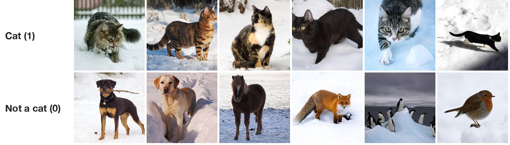
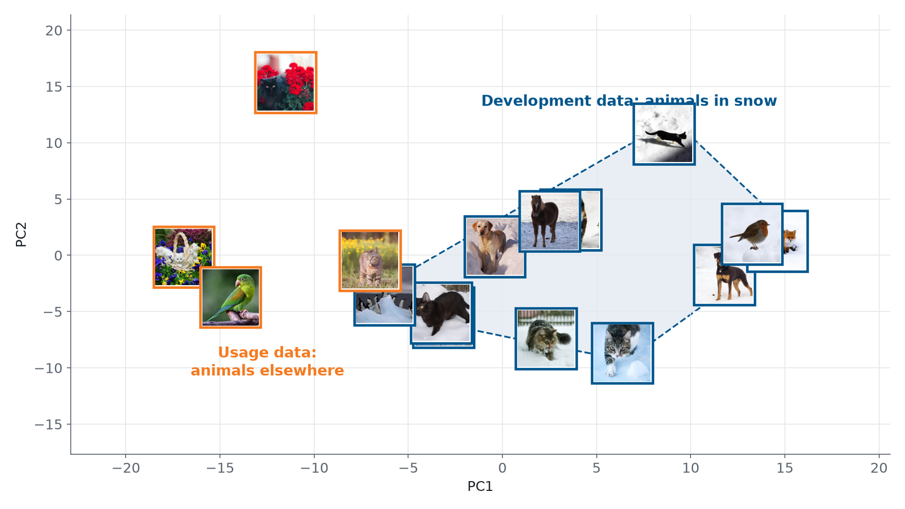
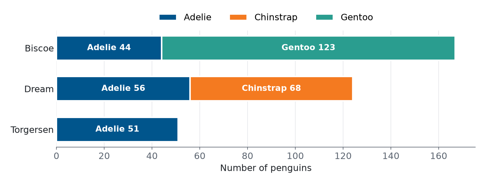
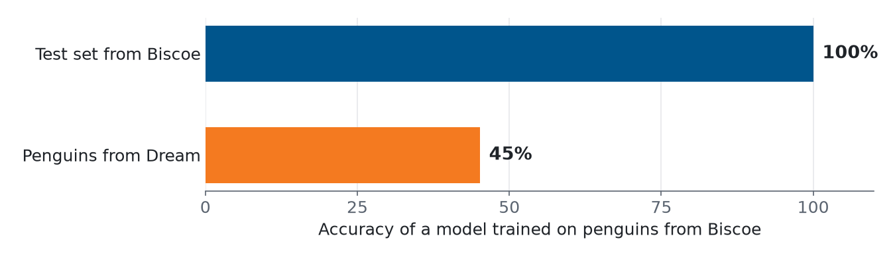
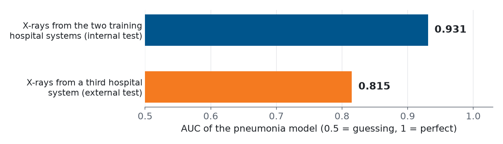
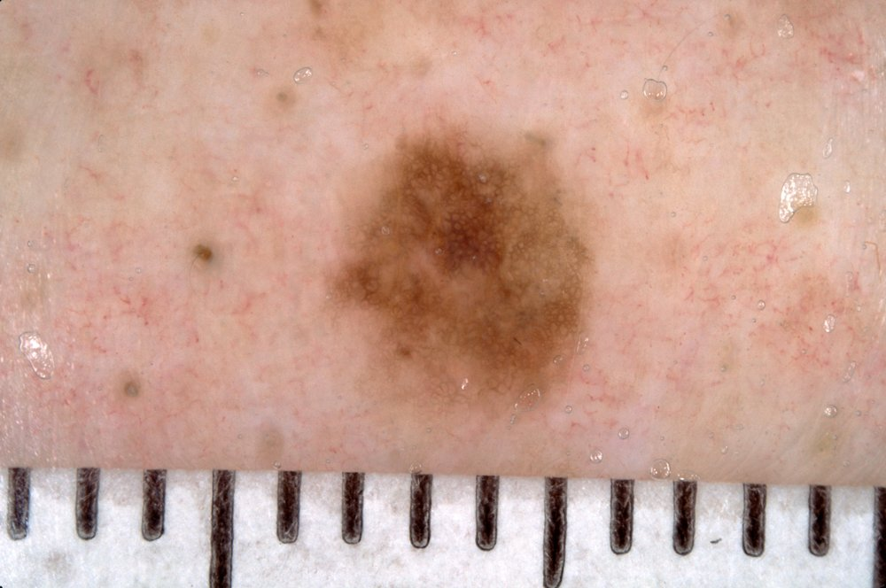
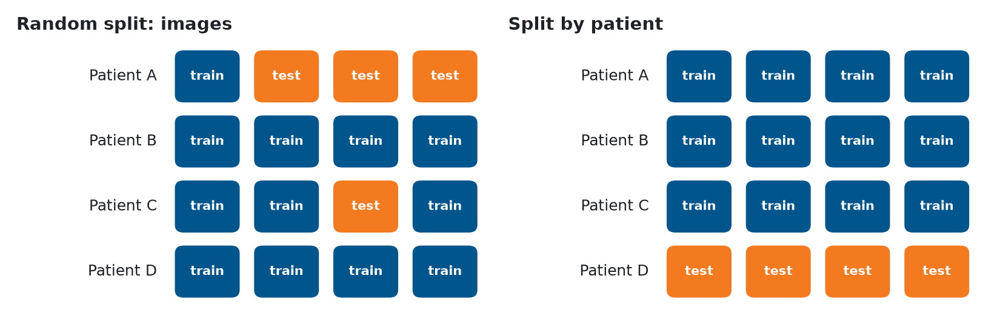
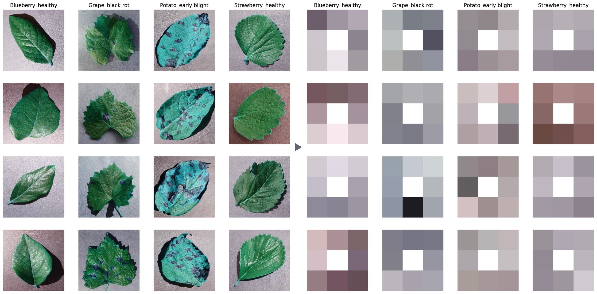

# Leakage and Distribution Shift

<!-- This file is the source of a page on the course website. Read it there: https://ai.buas.nl/open-courses/introduction-to-ml/self-study/theme-2/03_leakage_and_distribution_shift.html -->

A data science company builds a model for a client and reports 90% accuracy on its test set. The client starts using the model and finds that it is right only 60% of the time. Nobody made a programming mistake. The test score was correct for the test set, but the test set did not look like the data the model met in use.

This happens often, also in published research. This page shows the most common reasons, with examples from real projects:

1. the data distribution: what a dataset represents, and what it does not;
2. out-of-distribution data: cases unlike the ones the model was trained on;
3. data from different sources, and what a model can learn from the source;
4. leakage: when the test set is not independent of the training set;
5. how to make your development data match the data the model will be used on.

## 1. The data distribution

A dataset is a sample. Behind it are all the cases the model could meet, for example all photos that people might ask a cat detector about. The **data distribution** describes these cases: which kinds exist, how often each occurs, and which label goes with them. Your dataset shows only part of it.

::: {.column-margin}
**Data distribution**: the kinds of cases that can occur, how often each occurs, and which label goes with them. A dataset is a sample from it.
:::

Suppose you want a model that tells whether a photo shows a cat. You collect labeled photos, split them into a training set and a test set, train a model and get a high test score. These are some of the photos:

{fig-alt="Two rows of six photos. Top row, labeled Cat (1): six cats in snow. Bottom row, labeled Not a cat (0): two dogs, a horse, a fox, penguins and a robin, all in snow."}

Every photo was taken in snow. The training set and the test set come from the same collection, so the test photos are snowy too. The test score tells you how well the model recognizes cats in snow. It tells you nothing about the photos below, which a user could just as well upload:

{fig-alt="Four photos without snow: kittens in a basket among pansies, a black cat among red flowers, a tabby cat in a field of yellow flowers, and a green parrot."}

The data you use to build and test a model is the **development data**. The data the model receives once people use it is the **usage data**. A test score is a good estimate of the performance in use only when both come from the same distribution.

::: {.column-margin}
**Development data**: the data used to build a model: the training, validation and test sets.

**Usage data**: the data a model receives when it is used.
:::

### Looking at the distribution

You can check whether two sets of data look alike. In [Data Understanding](02_data_understanding.ipynb) you used principal component analysis (PCA) to reduce many features to two. Here each photo is shrunk to 32 × 32 pixels, which gives 3,072 numbers per photo (32 × 32 pixels, each with a red, a green and a blue value), and PCA reduces them to two:

{fig-alt="Scatter plot with PC1 on the horizontal and PC2 on the vertical axis, where each point is drawn as a small photo. The twelve snow photos, framed in blue, lie together in a region outlined with a dashed line and labeled development data, animals in snow. Three of the four photos without snow, framed in orange, lie far to the left of that region; the cat in yellow flowers lies at its edge."}

The snow photos lie close together. Most usage photos lie outside that region. For them, the model has to make predictions for kinds of photos it has never seen. With real data you do the same: put the development data and the usage data (or a sample of it) in one plot, color the points by where they come from, and look at whether they overlap.

## 2. Out-of-distribution data

A case that comes from another distribution than the development data is **out of distribution** (OOD). A model has no reliable way to handle such a case. It still gives an answer, often with high confidence, because a model always produces a prediction, whatever the input.

::: {.column-margin}
**Out-of-distribution (OOD) data**: cases that come from another distribution than the data a model was developed on.
:::

You can see this with the penguins from the [Getting Started](../theme-1/02_getting_started.ipynb) notebook. They were measured on three islands, and the species are not spread evenly over them:

{fig-alt="Stacked horizontal bar chart. Biscoe: 44 Adelie and 123 Gentoo. Dream: 56 Adelie and 68 Chinstrap. Torgersen: 51 Adelie."}

Train a logistic regression model on the four measurements of the penguins from Biscoe, and test it on a held-out quarter of the Biscoe penguins. It classifies all of them correctly. Then use it on the penguins from Dream:

{fig-alt="Horizontal bar chart. Test set from Biscoe: 100% accuracy. Penguins from Dream: 45% accuracy."}

The model has never seen a Chinstrap penguin, so it calls every Chinstrap an Adelie or a Gentoo. The test score of 100% was correct, but only for penguins like the ones from Biscoe.

The same happens in medicine. Zech et al. (2018) trained models that detect pneumonia on chest X-rays, using X-rays from three hospital systems in the United States. The best model reached an AUC of 0.931 on new X-rays from the two hospital systems it was trained on, and 0.815 on X-rays from the third one. (The AUC is a score between 0.5 for guessing and 1 for a perfect model; you learn it in Theme 3.)

{fig-alt="Horizontal bar chart. AUC on X-rays from the two training hospital systems: 0.931. AUC on X-rays from a third hospital system: 0.815."}

A news article in *Science* summarized the concern: "Most AI software is designed and tested in one hospital, and it risks faltering when transferred to another" (Couzin-Frankel, 2019).

## 3. Data from different sources

Data often comes from more than one source: several hospitals, several machines, several labs, several islands. Combining sources gives you more data and more variety, which is good. But sources differ in ways that have nothing to do with the task: the equipment, the settings, the way people take a photo or record a measurement, and the cases each source sees. A model can pick up these differences.

In the study by Zech et al., a model could tell from an X-ray alone which hospital system it came from, for 99.95% and 99.98% of the X-rays of two of the systems. At the same time, 34.2% of the X-rays from one hospital system showed pneumonia, against 1.2% and 1.0% at the other two. Sorting the X-rays by hospital system alone, without looking for pneumonia at all, already gave an AUC of 0.861. A model can reach a good score by recognizing the hospital instead of the disease, and that does not work in a new hospital.

A source can also leave a visible trace. Narla et al. (2018) describe a model that classifies photos of skin lesions as benign or malignant: "we noted that the algorithm appeared more likely to interpret images with rulers as malignant. Why? In our dataset, images with rulers were more likely to be malignant; thus the algorithm inadvertently 'learned' that rulers are malignant." A dermatologist puts a ruler next to a lesion that looks suspicious, so the ruler goes with the label in the data, but it is not part of the lesion.

{fig-alt="Close-up of a brown mole on skin, with a millimeter ruler along the bottom edge of the photo." width="70%"}

The cat photos have the same risk. In them, both the cats and the other animals are in snow, so snow does not help to separate them. If the cats had all been photographed in snow and the other animals indoors, a model could reach a high score by detecting snow.

When you combine sources:

- keep the source of every data point as a column, even if you don't use it as a feature;
- compare the sources: the label distribution of each source, and the features, for example with PCA, colored by source;
- check how the model does on each source separately, not only on all data together.

## 4. Leakage

A train/test split only gives an honest score if the test set tells the model nothing it could not know when it is used. **Leakage** is when information from the test set, or information that would not be available in use, gets into training. The test score is then better than the real performance.

::: {.column-margin}
**Leakage**: information that the model should not have, for example about the test set, gets into training, so the test score is too optimistic.
:::

### Dependent data points

A random split assumes that the data points are independent: knowing one tells you nothing about another. Statisticians call data points that are independent and all come from the same distribution **independent and identically distributed** (IID). Real data is often not like that. Two data points are dependent when they share something besides the label: the same patient, the same background, the same ruler. If one ends up in the training set and the other in the test set, the model can recognize what they share, and the test score goes up.

::: {.column-margin}
**IID (independent and identically distributed)**: data points that do not depend on each other and all come from the same distribution. A random split assumes this.
:::

The first version of the CheXNet paper (Rajpurkar et al., 2017), on pneumonia detection in chest X-rays, described a random split of 112,120 X-rays into 80% training and 20% validation data. The X-rays came from 30,805 patients, so many patients had several X-rays. Other researchers asked whether X-rays of the same patient had ended up on both sides of the split (Oakden-Rayner, 2018). From the second version on, the paper described a split in which no patient is in more than one set. With several images per patient, a random split puts most patients on both sides:

{fig-alt="Two grids of four rows (patients A to D) with four boxes each. Left, random split: patient A has one training and three test images, patient C has one test image. Right, split by patient: patients A to C are in the training set, all four images of patient D are in the test set."}

In the random split, the model has seen patient A and patient C during training, so the test set partly measures how well the model recognizes patients. In the split by patient, the test set contains a patient the model has never seen, as in use. scikit-learn has splitters for this, such as `GroupShuffleSplit`, which keep every group (here: every patient) on one side:

```python
from sklearn.model_selection import GroupShuffleSplit

splitter = GroupShuffleSplit(n_splits=1, test_size=0.2, random_state=42)
train_idx, test_idx = next(splitter.split(X, y, groups=patient_id))
```

Inside cross-validation the same idea is `GroupKFold`: you pass `groups=patient_id` to `cross_validate`, and each fold keeps all X-rays of a patient together. Theme 3 shows it in [Cross-validation by group](../theme-3/01_modeling_and_evaluation.ipynb#cross-validation-by-group).

A shared background works the same way. PlantVillage is a public dataset of photos of plant leaves in 38 classes (a plant species and a disease, or healthy), and published deep-learning models reach more than 99% accuracy on it. In the dataset, the leaves of each class were often photographed against similar backgrounds. Noyan (2022) kept only 8 pixels from the background of each photo, at its corners and edges, and trained a random forest on them:

{fig-alt="Two grids of four columns and four rows. Left: leaf photos of blueberry (healthy), grape (black rot), potato (early blight) and strawberry (healthy) on gray and pinkish backgrounds. Right: each photo reduced to a 3 by 3 grid of gray and brownish squares with a white center square."}

The model never saw a leaf, and it still classified 49.0% of the test photos correctly, where guessing would give 2.6% (1 in 38). The background tells the model something about the class, so a high score on this dataset does not prove that a model has learned to recognize the disease on the leaf.

### Other kinds of leakage

- The same case twice: a duplicate, possibly recorded under another name or in another format, with one copy in the training set and one in the test set.
- Preparing the data with the test set included: if you fit a scaler or fill in missing values using all data before you split, the training data contains information about the test set. In Theme 4 you learn how pipelines prevent this.
- Features that are only known after the answer: for example, using "the treatment the patient received" to predict the diagnosis that led to that treatment.

## 5. Matching development and usage data

You can rarely collect data that covers every case a model will meet. The world is larger than any dataset, and it changes over time. What you can do is make your development data resemble the usage data as closely as possible, and know where it does not. Three habits help.

Be skeptical of high scores. Ask what else the model could be using besides the thing you want it to learn: the background, the source, the patient, a ruler. A test like the 8-pixel experiment is cheap: train a model on information that should be useless, and if it does much better than guessing, there is a shortcut in the data.

Validate externally. Test the model on data that was collected separately from the development data: another hospital, another island, another lab, a later period. This is **external validation**. If the score drops, the model depends on something specific to the development data.

::: {.column-margin}
**External validation**: testing a model on data collected separately from the data it was developed on, for example from another source or a later period.
:::

Match the distributions. Collect development data from the conditions in which the model will be used. Split by group when data points are dependent. When you combine sources, check which source is most like the usage data, and test on data like it. And state for which cases your model has been tested, so that nobody uses it far outside them.

## Review

::: {.quiz data-answer="3"}
A model that detects cats was trained and tested on photos that were all taken in snow. It reaches 95% accuracy on the test set. What does this score tell you?

- The model will be right about 95% of the time on any cat photo, wherever it was taken. [The test photos were all taken in snow, so the score only covers photos like those (section 1).]{.feedback}
- The model has overfitted, because 95% is too high for this task. [Overfitting shows as a much lower test score than training score. Here the test score is high; the question is what it covers (section 1).]{.feedback}
- The model is right about 95% of the time on photos like the test photos: animals in snow. [The test set comes from the same distribution as the training set, so the score is an estimate for that distribution only (section 1).]{.feedback}
:::

::: {.quiz data-answer="2"}
A dataset has 10 X-rays of each of 500 patients. You split the 5,000 X-rays at random into a training and a test set. What is the problem?

- The test set is too small to give a reliable score for 500 patients. [With 1,000 or so test X-rays, the size is fine. The problem is which X-rays end up in it (section 4).]{.feedback}
- X-rays of one patient end up in both sets, so the score is too optimistic. [The model can recognize patients it has seen during training. Split by patient instead, for example with `GroupShuffleSplit` (section 4).]{.feedback}
- The classes are not balanced, because a random split ignores the labels. [That may be true, but it is not caused by the random split. The problem is that the X-rays of one patient depend on each other (section 4).]{.feedback}
:::

::: {.quiz data-answer="1"}
A model trained on data from hospital A does well on a test set from hospital A, but much worse on data from hospital B. What is the most likely explanation?

- The data from hospital B comes from another distribution. [Hospitals differ in equipment, settings and patients, and the model may depend on what is specific to hospital A (sections 2 and 3).]{.feedback}
- The test set of hospital A was too large, which made its score too optimistic. [A larger test set gives a more precise estimate, not a worse one. The difference comes from the data of hospital B (section 2).]{.feedback}
- The model is underfitting, so it cannot handle the more varied data of hospital B. [An underfitting model does badly on hospital A too. Here it only does badly on hospital B (section 2).]{.feedback}
:::

::: {.quiz data-answer="2"}
How can you find out whether a model depends on something specific to your development data?

- Train it longer and check whether the test score keeps going up. [More training does not show what the model depends on; it may even make it rely on the shortcut more (section 5).]{.feedback}
- Test it on data that was collected separately, from another source. [This is external validation. A drop in score shows that the model depends on something specific to the development data (section 5).]{.feedback}
- Split the data again at random, with a different seed, and compare. [A different seed gives another random split of the same data, with the same problem (section 4).]{.feedback}
:::

::: {.quiz data-answer="2"}
You have 2,000 measurements from 40 machines, about 50 per machine, and the model will be used on new machines. Which validation gives an honest estimate?

- A random 80/20 split of the measurements, repeated with five seeds. [Every split puts measurements of the same machine on both sides, so the score shows how well the model knows these machines (section 4).]{.feedback}
- Cross-validation with folds by machine, for example with `GroupKFold`. [Each fold validates on machines the model has not seen, as in use (section 4).]{.feedback}
- Stratified cross-validation, so that every fold has the same mix of classes. [Stratification keeps the class mix equal, but measurements of the same machine still end up on both sides (section 4).]{.feedback}
:::

## Further reading

- Zech, J. R., Badgeley, M. A., Liu, M., Costa, A. B., Titano, J. J., & Oermann, E. K. (2018). [Variable generalization performance of a deep learning model to detect pneumonia in chest radiographs: A cross-sectional study](https://doi.org/10.1371/journal.pmed.1002683). *PLOS Medicine*, 15(11), e1002683.
- Narla, A., Kuprel, B., Sarin, K., Novoa, R., & Ko, J. (2018). [Automated classification of skin lesions: From pixels to practice](https://doi.org/10.1016/j.jid.2018.06.175). *Journal of Investigative Dermatology*, 138(10), 2108–2110.
- Rajpurkar, P., Irvin, J., Zhu, K., et al. (2017). [CheXNet: Radiologist-level pneumonia detection on chest X-rays with deep learning](https://arxiv.org/abs/1711.05225). arXiv:1711.05225. Compare the data section of version 1 with that of version 2.
- Oakden-Rayner, L. (2018). [CheXNet: an in-depth review](https://laurenoakdenrayner.com/2018/01/24/chexnet-an-in-depth-review/). Blog post.
- Noyan, M. A. (2022). [Uncovering bias in the PlantVillage dataset](https://arxiv.org/abs/2206.04374). arXiv:2206.04374.
- Couzin-Frankel, J. (2019). [Artificial intelligence could revolutionize medical care. But don't trust it to read your x-ray just yet](https://www.science.org/content/article/artificial-intelligence-could-revolutionize-medical-care-don-t-trust-it-read-your-x-ray). *Science*.

::: {.callout-note collapse="true"}
## Image credits

The photos of animals are from Wikimedia Commons, under the licenses below. They were cropped and resized.

- [08-dec-17 (3124650822)](https://commons.wikimedia.org/wiki/File:08-dec-17_(3124650822).jpg), Paul Joseph, [CC BY 2.0](https://creativecommons.org/licenses/by/2.0)
- [202101 Romeo im Schnee 2](https://commons.wikimedia.org/wiki/File:202101_Romeo_im_Schnee_2.jpg), Thomas Mayer, [CC BY-SA 4.0](https://creativecommons.org/licenses/by-sa/4.0)
- [A walk in the Oregon snow](https://commons.wikimedia.org/wiki/File:A_walk_in_the_Oregon_snow_(2014_photo;_cropped_2021).jpg), Sheila Sund, [CC BY 2.0](https://creativecommons.org/licenses/by/2.0)
- [Blackcatsneaking](https://commons.wikimedia.org/wiki/File:Blackcatsneaking.JPG), Juan Ramirez, [CC BY-SA 3.0](https://creativecommons.org/licenses/by-sa/3.0/)
- [Cat in winter by svklimkin](https://commons.wikimedia.org/wiki/File:Cat_in_winter_by_svklimkin_(2019;_cropped_2023).jpg), svklimkin, [CC BY-SA 2.0](https://creativecommons.org/licenses/by-sa/2.0)
- [Abruzzo-il gatto](https://commons.wikimedia.org/wiki/File:Abruzzo-il_gatto_(2017;_cropped_2025).jpg), Anila Amataj, [CC BY-SA 4.0](https://creativecommons.org/licenses/by-sa/4.0)
- [03 Snow Bunny Talitha Rottweiler](https://commons.wikimedia.org/wiki/File:03_Snow_Bunny_Talitha_Rottweiler.jpg), This Pilgrim's Progress, [CC BY 2.0](https://creativecommons.org/licenses/by/2.0)
- [Afra 011](https://commons.wikimedia.org/wiki/File:Afra_011.jpg), public domain
- [A neighbors horse wandered up](https://commons.wikimedia.org/wiki/File:A_neighbors_horse_wandered_up_as_I_drove_by_waving_a_camera_-_%22Come_here!_Don%27t_you_want_to_be_on_flickr%3F%3F%3F%22_(3032562946).jpg), cogdogblog, [CC0](https://creativecommons.org/publicdomain/zero/1.0/)
- [Portrait of a red fox in Rautas fjällurskog](https://commons.wikimedia.org/wiki/File:Portrait_of_a_red_fox_in_Rautas_fj%C3%A4llurskog.jpg), ClaudiaTen, [CC BY-SA 4.0](https://creativecommons.org/licenses/by-sa/4.0)
- [Adelie Penguins on iceberg](https://commons.wikimedia.org/wiki/File:Adelie_Penguins_on_iceberg.jpg), Jason Auch, [CC BY 2.0](https://creativecommons.org/licenses/by/2.0)
- [Robin in the snow 1](https://commons.wikimedia.org/wiki/File:Robin_in_the_snow_1_(4250398331).jpg), Tony Hisgett, [CC BY 2.0](https://creativecommons.org/licenses/by/2.0)
- [Basket Full Of Kittens](https://commons.wikimedia.org/wiki/File:Basket_Full_Of_Kittens_(62200211).jpeg), Vanessa Kay, [CC BY 3.0](https://creativecommons.org/licenses/by/3.0)
- [Beautiful Black Betty](https://commons.wikimedia.org/wiki/File:Beautiful_Black_Betty_(50021989762).jpg), Reba Spike, [CC BY 2.0](https://creativecommons.org/licenses/by/2.0)
- [Allie Cat in flower field](https://commons.wikimedia.org/wiki/File:Allie_Cat_in_flower_field_(50070678346)_(2020;_cropped_2026).jpg), Reba Spike, [CC BY 2.0](https://creativecommons.org/licenses/by/2.0)
- [Brotogeris jugularis (Perico broncíneo)](https://commons.wikimedia.org/wiki/File:Brotogeris_jugularis_(Perico_bronc%C3%ADneo)_-_Flickr_-_Alejandro_Bayer_(1).jpg), Alejandro Bayer Tamayo, [CC BY-SA 2.0](https://creativecommons.org/licenses/by-sa/2.0)

The mole photo is ISIC_0011814 from the [ISIC Archive](https://www.isic-archive.com/), CC0. The PlantVillage figure combines Figures 1 and 3 of Noyan (2022), CC BY 4.0, which show photos from the PlantVillage dataset (Hughes and Salathé, 2015, [arXiv:1511.08060](https://arxiv.org/abs/1511.08060)), CC BY-SA 3.0. The charts and the split diagram were made for this course from the Palmer penguins data and the results reported by Zech et al. (2018).
:::

<script src="../../assets/quiz.js"></script>

<!-- course-route-note: written by tools/course_route_notes.py from filters/course-route.yml; on the website the Next callout replaces it -->

## What comes next

This is the end of Self-study Theme 2. If you follow the course route, you have finished the first part of step 2 of 6. The [course route](../../README.md#the-course-route) in the README lists the second part of the step (on the website: the [Course Guide](https://ai.buas.nl/open-courses/introduction-to-ml/course-guide.html#the-course-route)).

<!-- /course-route-note -->
